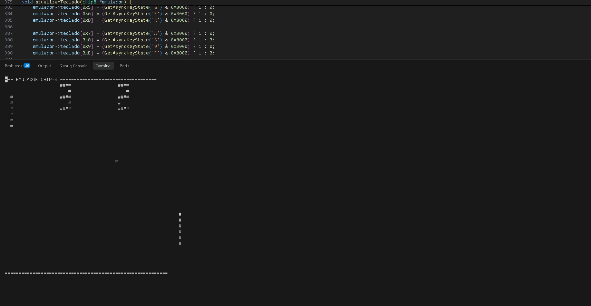

# Emulador CHIP-8 em C++ com Win32 API

[](README-en.md)
[](README.md)


[](https://github.com/VitorAngN/oldCPUEmulator/actions/workflows/ci.yml)

Um emulador completo da CPU CHIP-8 (sistema da década de 70) desenvolvido do zero em C++ moderno. 
Este projeto foi construído para demonstrar profundidade técnica em engenharia de software, saindo do nível de scripting procedural para uma arquitetura orientada a objetos (OOP) totalmente desacoplada.

**O diferencial técnico:** A renderização gráfica e o input não utilizam bibliotecas prontas como SDL2 ou SFML. O emulador "conversa" diretamente com o sistema operacional através da **Win32 API nativa** (`<windows.h>`), desenhando pixels diretamente na placa de vídeo, garantindo zero dependências externas para compilação.

<p align="center">
  
  <br/>
  <em>Emulador CHIP-8 executando Pong via Win32 API nativa</em>
</p>

## Arquitetura e Engenharia

O projeto foi dividido em dois domínios principais (desacoplamento):

1. **Domínio da CPU (`Chip8.cpp` & `Chip8.hpp`)**: 
   - Focado exclusivamente em emular os barramentos de hardware. Nenhuma linha de código aqui sabe da existência de uma janela ou teclado físico.
   - **Memória RAM:** 4KB (4096 bytes).
   - **Registradores:** 16 registradores de uso geral (V0 a VF) + Registrador de Índice de 16-bits (I).
   - **Timers:** Sistema de interrupção simulado para *Delay* e *Sound* a 60Hz.

2. **Domínio de Interface (`main.cpp`)**:
   - Integração com o SO via Win32 API.
   - Criação da janela via `CreateWindowEx`.
   - Processamento contínuo da fila de mensagens do Windows (`PeekMessage` e `DispatchMessage`).
   - Sincronização de clock: A CPU roda a aproximadamente 300Hz, enquanto o desenho na tela e os timers são sincronizados a 60Hz.

## Como Compilar e Rodar

Não é necessário instalar ferramentas complexas ou o CMake. Basta ter o compilador G++ (MinGW) no seu Windows.

1. Clone o repositório:
```bash
git clone https://github.com/VitorAngN/oldCPUEmulator.git
cd oldCPUEmulator/emular8hd
```

2. Compile usando o script otimizado que já lida com a linkagem da GDI32:
```bash
# Ou simplesmente dê dois cliques no arquivo build.bat pelo Windows Explorer
.\build.bat
```

3. Execute passando a ROM desejada como argumento:
```bash
chip8_emulator.exe pong.ch8
```
*(Se você não passar nenhum argumento, ele tentará carregar `pong.ch8` automaticamente).*

## Testes

O núcleo da CPU (`Chip8.cpp`) não depende do Windows, então é testado em qualquer sistema. Os testes em `tests/test_chip8.cpp` montam pequenos programas em memória, executam alguns ciclos e conferem registradores, memória e tela: aritmética com flags, saltos e sub-rotinas, BCD, fonte, desenho com colisão e recorte, timers e espera de tecla.

```bash
cmake -S . -B build
cmake --build build
ctest --test-dir build --output-on-failure
```

O GitHub Actions roda os testes no Linux com AddressSanitizer/UBSan (detectam acesso fora da memória) e compila o emulador completo no Windows com MinGW.

### Bugs encontrados e corrigidos pelos testes
- **Frames perdidos:** `drawFlag` era zerado a cada ciclo; como o loop executa 4 ciclos por frame, um desenho no 1º ciclo era esquecido.
- **Flag sobrescrita:** em `8XY4/5/6/7/E` com `X = F`, a flag era gravada antes do resultado e se perdia.
- **Sprite vazando:** pixels além da coluna 63 apareciam no começo da linha de baixo; agora o sprite é recortado na borda.
- **Acesso fora da memória:** pilha sem limite (`2NNN` com 16 chamadas, `00EE` com pilha vazia) e endereços de `I` acima de `0xFFF` agora são protegidos.

## Autor

Desenvolvido por **João Vitor Angelim Nogueira**.  
Estudante de Engenharia da Computação focado em Engenharia de Software, Backend e DevOps, buscando aprofundar-se desde o "escovador de bits" até arquiteturas distribuídas e infraestrutura robusta.
